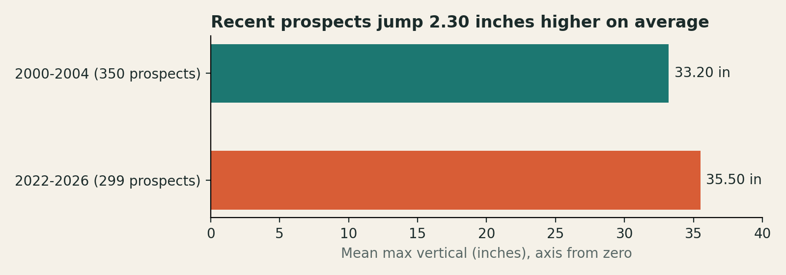

# Do today's NBA prospects jump higher than those of twenty years ago?

This is the course folder Dr. Q built on camera for Labs 4 and 5 of M310 Sport Analytics at Indiana University, published as an example of a project repository. The stakeholder is a scouting director who compares a prospect's combine numbers with past draft classes, and the question compares the maximum vertical leap of prospects measured at the NBA Draft Combine in 2000-2004 with those measured in 2022-2026.

**Report page:** https://tyrealq.github.io/m310-lab-example/QIAN_LAB5.html

## The finding

Prospects in 2022-2026 averaged a maximum vertical of 35.50 inches, against 33.20 inches for prospects in 2000-2004, a difference of 2.30 inches across 299 and 350 prospects with a recorded result. A two-sided Welch t-test gives a p-value less than .001, and the difference is 0.64 of a standard deviation. The result covers the maximum vertical only, and it cannot rule out a different pattern on the other combine measures.

## What is in the folder

| File | What it holds |
|---|---|
| `QIAN_LAB5.html` | The report page, one file that opens in any browser |
| `AGENTS.md` | The question, the data, and the rules the agent worked under, read at the start of every session |
| `PROJECT_BRIEF.md` | The full plan: the stakeholder, the data scope, and the data-quality requirements |
| `Lab4_Data_Dictionary.md` | What each column of the data means |
| `Lab5_Notes.md` | The second session's review of the test, and what was done about it |
| `build_workbook.py` | The code that builds the workbook from the unchanged CSV |
| `run_tests.py` | The code that runs the t-test and the other tests on the workbook's Clean sheet |
| `axis_32.html` | The yearly chart on an axis from 32 to 37 inches, kept as a working file |
| `.agents/skills/` | The skills the agent used: `officecli-xlsx` to build the workbook, `q-eda` to profile the data, and `scout-results`, adapted from q-results to write results for a scouting director |

The history of this repository is the record of how the work was built: each commit is one step, with a message that states what changed and why.

## The data

The data is the Kaggle dataset **NBA Draft Combine**, https://www.kaggle.com/datasets/marcusfern/nba-draft-combine, used under its CC BY 4.0 license. The CSV and the workbook are left out of this repository by `.gitignore`, and the steps below rebuild the workbook from the download.

## Rebuild the workbook

1. Download `nba_draft_combine.csv` from the dataset's Kaggle page and put it in this folder, unchanged.
2. Install OfficeCLI, which `build_workbook.py` uses to write the workbook: https://github.com/iOfficeAI/OfficeCLI.
3. Install the Python packages the tests use: `pip install openpyxl scipy`.
4. Run `python3 build_workbook.py`. It writes `QIAN_LAB4.xlsx` with the Raw, Clean, Decision_Log, Benchmarks, and Checks sheets.
5. Run `python3 run_tests.py` to print the test results the page reports.

## Credits

`officecli-xlsx` comes from iOfficeAI/OfficeCLI (Apache-2.0 license). `q-eda` and the q-results skill that `scout-results` adapts come from TyrealQ/q-skills (MIT license).
